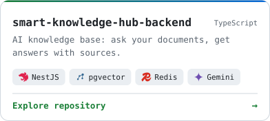
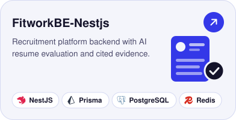
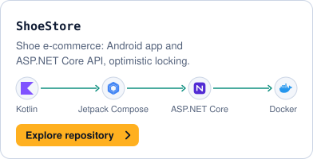
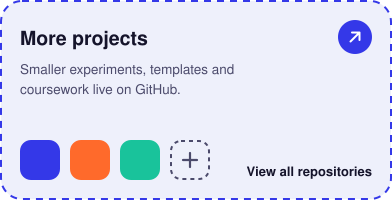
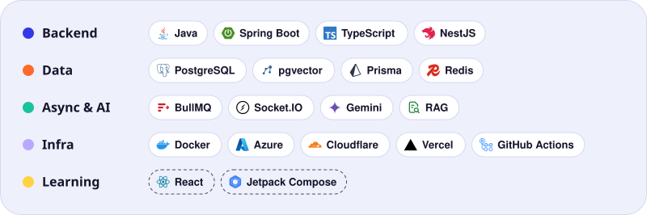

<picture>
  <source media="(prefers-color-scheme: dark)" srcset="assets/header-dark.svg">
  
</picture>

## Projects

<table>
  <tr>
    <td width="50%">
      <a href="https://github.com/tqha1011/smart-knowledge-hub-backend">
        <picture>
          <source media="(prefers-color-scheme: dark)" srcset="assets/project-smart-knowledge-hub-dark.svg">
          
        </picture>
      </a>
    </td>
    <td width="50%">
      <a href="https://github.com/tqha1011/FitworkBE-Nestjs">
        <picture>
          <source media="(prefers-color-scheme: dark)" srcset="assets/project-fitwork-dark.svg">
          
        </picture>
      </a>
    </td>
  </tr>
  <tr>
    <td width="50%">
      <a href="https://github.com/tqha1011/ShoeStore">
        <picture>
          <source media="(prefers-color-scheme: dark)" srcset="assets/project-shoestore-dark.svg">
          
        </picture>
      </a>
    </td>
    <td width="50%">
      <a href="https://github.com/tqha1011?tab=repositories">
        <picture>
          <source media="(prefers-color-scheme: dark)" srcset="assets/project-more-dark.svg">
          
        </picture>
      </a>
    </td>
  </tr>
</table>

## Stack

<picture>
  <source media="(prefers-color-scheme: dark)" srcset="assets/stack-dark.svg">
  
</picture>

## Contact

[LinkedIn](https://www.linkedin.com/in/quang-h%E1%BA%A1-b6627a376/) · [Facebook](https://www.facebook.com/ha.tran.quang.710185)

<picture>
  <source media="(prefers-color-scheme: dark)" srcset="https://raw.githubusercontent.com/tqha1011/tqha1011/output/github-snake-dark.svg">
  
</picture>

