<picture>
  <source media="(prefers-color-scheme: dark)" srcset="assets/header-dark.svg">
  
</picture>

## Projects

<a href="https://github.com/tqha1011/smart-knowledge-hub-backend">
  <picture>
    <source media="(prefers-color-scheme: dark)" srcset="assets/card-rag-dark.svg">
    
  </picture>
</a>

<a href="https://github.com/tqha1011/FitworkBE-Nestjs">
  <picture>
    <source media="(prefers-color-scheme: dark)" srcset="assets/card-fitwork-dark.svg">
    
  </picture>
</a>

<a href="https://github.com/tqha1011/ShoeStore">
  <picture>
    <source media="(prefers-color-scheme: dark)" srcset="assets/card-shoestore-dark.svg">
    
  </picture>
</a>

## Stack

<picture>
  <source media="(prefers-color-scheme: dark)" srcset="assets/stack-dark.svg">
  
</picture>

## Contact

<picture>
  <source media="(prefers-color-scheme: dark)" srcset="https://raw.githubusercontent.com/tqha1011/tqha1011/output/github-snake-dark.svg">
  
</picture>

